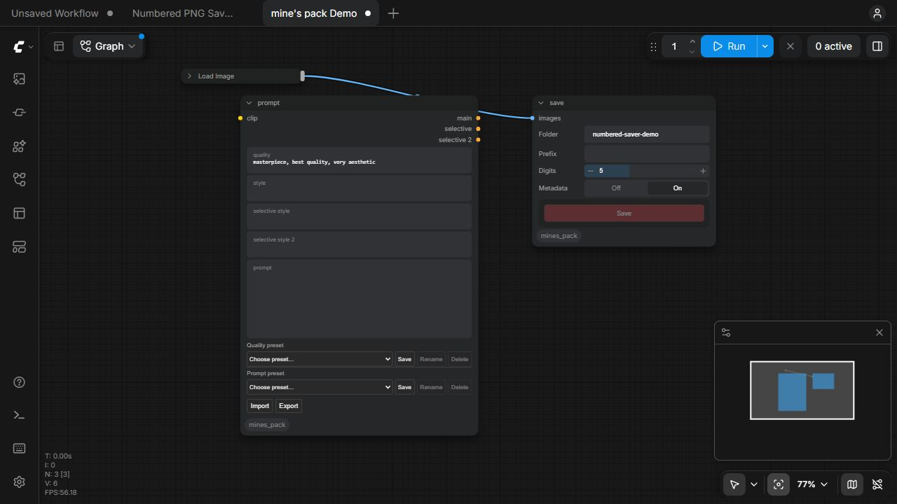

# mine's pack

Two custom nodes for ComfyUI **Nodes 2.0**: **prompt** and **save**.



## Install

From your ComfyUI `custom_nodes` directory:

```sh
git clone https://github.com/kuromatcha/mine-pack.git
```

Restart ComfyUI and refresh its frontend. Both nodes appear under **mine's pack** in the node library.

If upgrading from `prompt_sections`, `mines_pack`, or the standalone `ComfyUI-Numbered-PNG-Saver`, disable those old copies before restarting. Keep only one active copy of each node. Existing workflows retain their node IDs, input/output names and connections. Prompt presets remain available at the same ComfyUI address and browser profile.

## prompt

Connect a CLIP model and enter text in Quality, Style, Selective Style, Selective Style 2 and Prompt.

| Output | Combined text |
| --- | --- |
| main | Quality + Style + Prompt |
| selective | Quality + Selective Style + Prompt |
| selective 2 | Quality + Selective Style 2 + Prompt |

Empty sections are skipped; sections are joined with a comma and a space. Quality and style fields stay compact; only the Prompt field grows vertically. Quality and Prompt have separate browser-local preset libraries, with name, rename, delete and JSON import/export controls.

## save

Connect an IMAGE output and run the workflow once, then click **Save**. It exports the **first image** in the incoming batch without rerunning generation.

| Control | Behavior |
| --- | --- |
| Folder | Blank uses ComfyUI output. Relative paths use output subfolders; absolute paths use that folder on the backend computer. Missing folders are created. |
| Prefix | Blank produces `00001.png`; `character_` produces `character_00001.png`. |
| Digits | Minimum numeric width, default 5. |
| Metadata | On embeds ComfyUI prompt/workflow metadata; Off omits it. The global metadata-disable option takes priority. |
| Save | Red before saving, green after a successful save. No saved-text indicator. |

Each click scans matching PNG filenames and uses the highest number plus one: `00001.png`–`00046.png` becomes `00047.png`. Gaps are not filled and existing files are never overwritten, including concurrent saves. Output is an 8-bit lossless PNG using ComfyUI's standard pixel conversion.

Change settings before clicking Save to use the new destination immediately. Folder and Prefix also support ComfyUI's normal conversion to string inputs; connected values update when the workflow runs. New images or changed settings reset the button to red. Errors appear only if needed. The node's height fits its controls; bottom corners resize the width.

Images are staged in ComfyUI's temporary folder, not exported automatically. A new batch replaces the previous batch for that node. Staged images expire after 24 hours or a server restart; run the workflow again to refresh them. Expired staging data is cleaned during staging/startup.

## Example and checks

Copy `examples/sample-a.png` into ComfyUI's input folder, then open `example-workflow.json`. The example displays both nodes and tests saving without a model. Connect CLIP to **prompt** in your actual generation workflow.

Tested on Windows with ComfyUI **0.44.2**, frontend **1.57.6**, and Python **3.13.12**, with Nodes 2.0 enabled. No additional dependencies are required beyond ComfyUI's existing dependencies.

Run the exporter checks with ComfyUI's Python:

```sh
python tests/test_exporter.py
```

Internal workflow identifiers remain `PromptSectionsCond` and `NumberedPNGSaver`.
