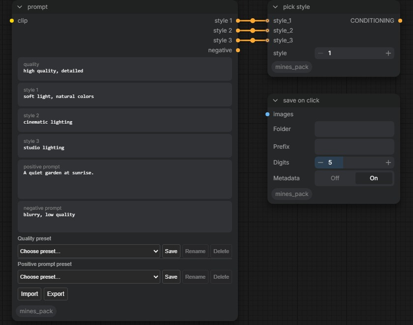

# mines-pack

Shows as **mine's pack** in ComfyUI.



- **prompt** — quality, style 1–3, a positive prompt and a two-line negative prompt, with presets. Outputs **style 1**, **style 2** and **style 3** (quality + that style + positive prompt) and **negative**.
- **save** — save the first image as a numbered PNG, with optional metadata. Click **Save** in the top bar to save the latest run.

For the [Mine's video workflows](https://github.com/kuromatcha/mines-img2vid):

- **load image (optional)** — Load Image with a "none" choice that outputs nothing, for optional end images.
- **SVIPro end frame** — KJNodes' Wan Image To Video SVIPro with an optional end image on the last frame.
- **color drift fix** — removes slow color drift (brightness, warmth, saturation, skin tone) so later frames keep the tone of the first frame; in a loop the end matches the start. Motion and short flashes are left alone.
- **keep source colors** — gives upscaled frames back the exact colors of the frames before upscaling (RTX upscaling shifts them slightly, differently per frame). Keeps the upscaler's fine detail and takes the colors pixel by pixel from the source frame.

On Windows the pack also hides the harmless *WinError 10054* traceback ComfyUI logs when a browser tab closes.

Clone into ComfyUI's `custom_nodes` folder, then restart ComfyUI:

```sh
git clone https://github.com/kuromatcha/mines-pack.git
```

Each output is encoded separately when you queue, so editing one style only re-runs the samplers that use it. This doesn't apply if a text box is fed by a link.
